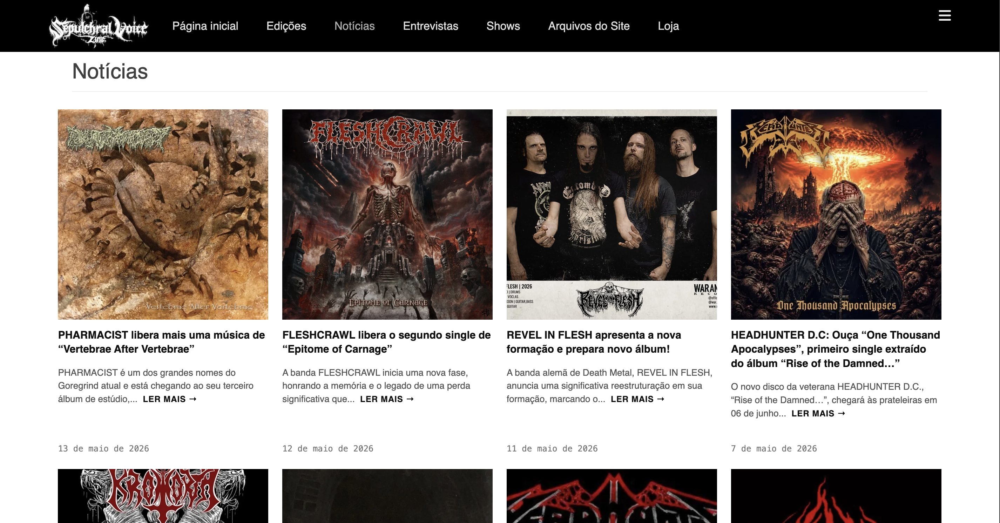
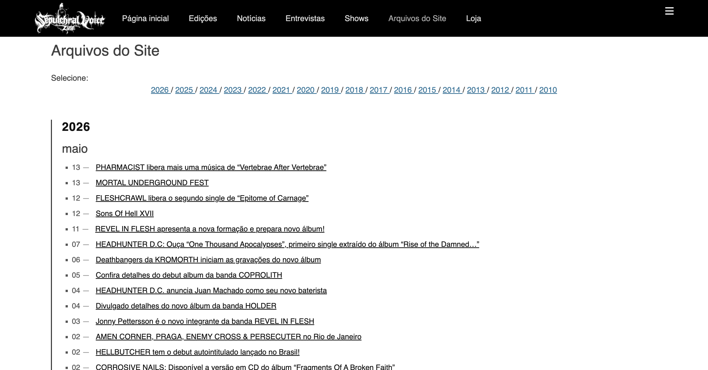
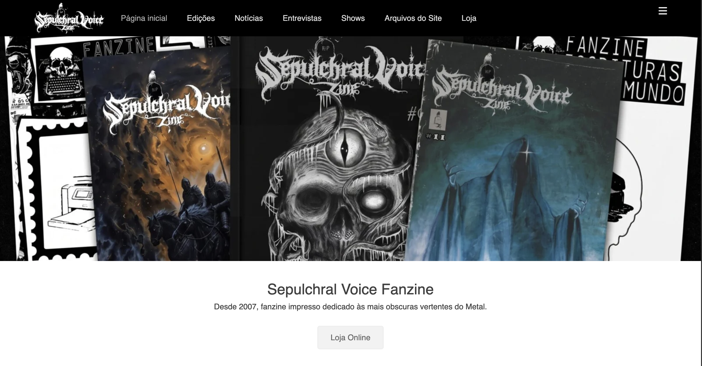

# Sepulchral Voice Fanzine — Legacy CMS Overhaul & Archive Standardization

Technical documentation covering the restoration, structural modernization, database remediation, and visual standardization of the **Sepulchral Voice Fanzine** editorial portal (WordPress / Full Frame Child Theme).

---

## 📌 Context & Objectives

This project focused on rescuing and stabilizing the digital infrastructure of an underground print publication, migrating the legacy environment to end-to-end HTTPS/SSL, sanitizing mixed-content database references, and redesigning historical archives into a clean, symmetric CSS Grid layout.

### Key Deliverables:
- **Security & Infrastructure:** Enforced end-to-end SSL/TLS certificates and sanitized legacy URLs via targeted MySQL search-and-replace routines.
- **Modern CSS Grid Layout:** Replaced the legacy blog flow with a 4-column symmetric grid (`.archive-gallery-grid`) on desktop, ensuring uniform cover aspect ratios and consistent typography.
- **Edge-to-Edge Visual Identity:** Implemented a full-bleed panoramic header (`100vw`), eliminating letterboxing and native parent-theme black border constraints.
- **Custom Institutional Footer:** Stripped third-party theme attribution links, integrating a continuous editorial copyright notice (**Copyright © 2007 – 2026 Sepulchral Voice**) alongside direct technical development attribution.

---

## 📸 Visual Assets (Screenshots)

### 1. Editorial Archive Grid (Desktop)
Standardized multi-column layout displaying album releases and news items with normalized typography.



### 2. Historical Taxonomy & Categorized Archive
Chronological release archives filtered by category and metadata taxonomies.



### 3. Edge-to-Edge Panoramic Header
Full-bleed header banner layout spanning the entire viewport width.



### 4. Institutional Custom Footer
Streamlined editorial footer with persistent copyright and clean attribution.


---

## 🛠️ Tech Stack

- **CMS:** WordPress
- **Base Theme:** Full Frame (Catch Themes)
- **Custom Layer:** Dedicated Child Theme (`functions.php`, `style.css`), CSS Grid, Flexbox
- **Hosting & Database:** PHP 8.x, MySQL / MariaDB, Hostinger / LiteSpeed Cache

---

## 📝 Known Issues & Technical Roadmap

### Mobile Navigation Drawer (Technical Debt / Backlog)
- **Root Cause Analysis:** The parent theme couples legacy DOM-manipulation scripts (`Sidr.js`) with rigid inline styling on `#fixed-header`. During mobile refactoring, automated breakpoints conflicted with fixed positioning rules, causing redundant drawer triggers and overlapping text nodes.
- **Architectural Decision:** To safeguard desktop production stability and preserve the newly implemented archive grid, aggressive CSS overrides were paused for this release cycle.
- **Planned Refactor:** Dequeue `fullframe-custom.js` via `wp_dequeue_script()` and override the template in `header.php` to deploy a lightweight, dependency-free CSS-first mobile drawer.

---

## 📂 Repository Structure

```text
├── child-theme/
│   ├── style.css             # CSS Grid overrides and full-bleed layout rules
│   └── functions.php         # Header/footer hooks and custom filters
├── docs/
│   └── screenshots/          # Visual verification assets
│       ├── desktop-archive-grid.png
│       ├── desktop-taxonomy-archive.png
│       ├── header-full-bleed.png
│       └── footer-custom.png
├── sql/
│   └── search-replace-ssl.sql # URL remediation queries for HTTPS migration
└── README.md
```

---

## 💻 Implementation Highlights

### 1. Database URL Remediation (`sql/search-replace-ssl.sql`)
To eliminate browser mixed-content warnings post-SSL provisioning without relying on resource-heavy dynamic rewriting plugins, direct database replacement routines were executed across core WordPress tables:

```sql
-- Core Site Configuration
UPDATE wp_options 
SET option_value = REPLACE(option_value, '[http://sepulchralvoicefanzine.com](http://sepulchralvoicefanzine.com)', '[https://sepulchralvoicefanzine.com](https://sepulchralvoicefanzine.com)') 
WHERE option_name IN ('home', 'siteurl');

-- Post & Page Content Strings
UPDATE wp_posts 
SET post_content = REPLACE(post_content, '[http://sepulchralvoicefanzine.com](http://sepulchralvoicefanzine.com)', '[https://sepulchralvoicefanzine.com](https://sepulchralvoicefanzine.com)');

-- Attachment & GUID References
UPDATE wp_posts 
SET guid = REPLACE(guid, '[http://sepulchralvoicefanzine.com](http://sepulchralvoicefanzine.com)', '[https://sepulchralvoicefanzine.com](https://sepulchralvoicefanzine.com)');

-- Post Metadata & Custom Fields
UPDATE wp_postmeta 
SET meta_value = REPLACE(meta_value, '[http://sepulchralvoicefanzine.com](http://sepulchralvoicefanzine.com)', '[https://sepulchralvoicefanzine.com](https://sepulchralvoicefanzine.com)');
```

---

## 2. Symmetric Archive Grid (`child-theme/style.css`)

Overrides the theme's single-column stacked blog flow with a robust CSS Grid declaration:

```css
/* Standardized Editorial 4-Column Grid */
.archive-gallery-grid {
    display: grid !important;
    grid-template-columns: repeat(4, minmax(0, 1fr)) !important;
    gap: 24px !important;
    width: 100% !important;
    margin: 30px auto !important;
    box-sizing: border-box !important;
}

.archive-gallery-grid .gallery-post-card {
    display: flex !important;
    flex-direction: column !important;
    background-color: transparent !important;
    border: none !important;
}

.archive-gallery-grid .gallery-post-thumbnail img {
    width: 100% !important;
    aspect-ratio: 1 / 1 !important;
    object-fit: cover !important;
    display: block !important;
}
```

---

## 3. Edge-to-Edge Panoramic Header (`child-theme/style.css`)

Breaks out of native nested container constraints to ensure full-bleed image presentation:

```css
/* Full-Bleed Panoramic Header */
#header-featured-image {
    width: 100vw !important;
    position: relative !important;
    left: 50% !important;
    right: 50% !important;
    margin-left: -50vw !important;
    margin-right: -50vw !important;
    overflow: hidden !important;
}

#header-featured-image img {
    width: 100% !important;
    height: auto !important;
    display: block !important;
}
```

---

## 4. Custom Footer Branding Hook (`child-theme/functions.php`)

Replaces vendor attribution filters with editorial copyright credits:

```php
<?php
/**
 * Unhooks Catch Themes default footer and injects custom editorial copyright.
 */
function fullframe_child_custom_footer_content() {
    ?>
    <div id="site-generator" class="three">
        <div class="wrapper">
            <div id="footer-left-content" class="copyright">
                Copyright &copy; 2007 &ndash; <?php echo date('Y'); ?> 
                <a href="<?php echo esc_url( home_url( '/' ) ); ?>">Sepulchral Voice Fanzine</a>. All Rights Reserved.
            </div>
            <div id="footer-right-content" class="powered">
                Infrastructure &amp; Layout Engineering by <a href="[https://github.com/julianareginap](https://github.com/julianareginap)" target="_blank" rel="noopener noreferrer">Juliana Regina</a>.
            </div>
        </div>
    </div>
    <?php
}

function fullframe_child_override_footer() {
    remove_action( 'fullframe_footer', 'fullframe_footer_content', 100 );
    add_action( 'fullframe_footer', 'fullframe_child_custom_footer_content', 100 );
}
add_action( 'init', 'fullframe_child_override_footer' );
```

---

## 🚀 Deployment & Environment Setup

1. Clone the repository:
```
git clone [https://github.com/julippereira/legacy-cms-overhaul.git](https://github.com/julianareginap/legacy-cms-overhaul.git)
```
2. Deploy the Child Theme:
- Upload child-theme/ to wp-content/themes/full-frame-child/.
- Activate the child theme via Appearance > Themes.
3. Run Database Migrations (Hostinger / phpMyAdmin):
- Execute the commands in `sql/search-replace-ssl.sql` using phpMyAdmin or WP-CLI (`wp search-replace).
4. Purge Cache:
- Clear Hostinger Server Cache and LiteSpeed Cache to ensure updated CSS rules take immediate effect.

---

## 📄 License

This project documentation and custom child-theme overrides are released under the MIT License.

